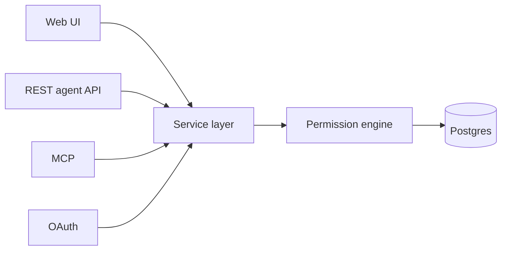

# Atlas

Company knowledge library. People use the web app. External tools use the same service through a personal access token, OAuth, or the MCP server. Every path asks one permission engine whether the caller can see or change a document.

Phase 1 does not generate answers. `AI_ENABLED` stays `false`.

## Quick start

Postgres and the API, using `backend/.env`:

```bash
docker compose up --build
```

The API listens on http://127.0.0.1:8000. The first boot runs migrations and creates the default department. It does not load the demo catalog. The first Google sign-in by an address in `SUPER_ADMIN_EMAILS` creates that person and the root folder.

Web app:

```bash
cd frontend
npm install
npm run dev
```

Open the origin in `PUBLIC_APP_URL` (http://localhost:5173). The Vite server proxies `/api`, `/oauth`, `/.well-known`, and `/mcp` to the API, so the session cookie stays on the page origin.

Sign in with Google. The button uses the client id from `GET /api/v1/config`. That origin must be an authorized JavaScript origin on the OAuth client. Test login stays off unless `ALLOW_TEST_LOGIN=true` on the API and `VITE_ENABLE_TEST_LOGIN=true` in the web app. Production refuses test login either way.

`GOOGLE_MODE=live` uses the service account and Shared Drive. `fake` is only for tests and accepts the in-memory demo file.

Checks:

```bash
cd backend && .venv/bin/pytest
cd frontend && npm test
cd frontend && npx playwright install chromium && npm run test:e2e
```

Playwright expects the API on port 8000 with the seed loaded and test login allowed. `npm run test:smoke` is the older in-browser mock walkthrough.

To scan dependencies: `./scripts/audit.sh`. To reject secrets on commit, run `git config core.hooksPath .githooks` once in this clone. The hook looks for private keys, AWS access key ids, `dms_pat_` secrets, and Slack tokens.

## Architecture



The browser, a bearer token, an MCP client, and an OAuth grant all call the same service functions. `accessible_documents_query` decides which rows exist for that caller. A hidden document is a 404. Tokens and OAuth grants cannot permanently delete documents, change permissions, administer users, change settings, or manage tokens.

## Roles and scopes

| Action | Super admin | Admin | Manager | Employee | Guest | `docs:read` | `docs:write` |
| --- | --- | --- | --- | --- | --- | --- | --- |
| View a document the permission engine allows | yes | yes | yes | yes | only an explicit grant | same as the user | same as the user |
| Edit a document the permission engine allows | yes | yes | department | own or granted | no | no | yes, when the user can edit |
| Create documents and folders | yes | yes | yes | yes | no | no | yes, in folders the user can edit |
| Share and change permissions | yes | yes | department | own | no | no | no |
| Users and invites | yes | yes | employees in their department | no | no | no | no |
| Taxonomy, org settings, every token | yes | yes | no | no | no | no | no |
| Permanent delete | yes | yes | no | no | no | no | no |
| Own tokens, grants, and audit | yes | yes | yes | yes | no | no | no |

External access is off for the whole workspace when an admin turns off **Allow external AI access**. New write scopes are refused when **Allow write scopes** is off. A token never lives longer than **Max token lifetime**.

## Environment

Copy `backend/.env.example` to `backend/.env` and `frontend/.env.example` to `frontend/.env`. Docker Compose already sets the values it needs.

| Variable | Where | Purpose |
| --- | --- | --- |
| `DATABASE_URL` | API | Postgres URL. Compose uses `atlas:atlas` on the `postgres` service. |
| `APP_ENV` | API | `development`, `test`, or `production`. Production cookies are `Secure`. |
| `JWT_SECRET` | API | Signs the `atlas_session` cookie. Change it outside local development. |
| `PUBLIC_BASE_URL` | API | Origin agents use. MCP is `{PUBLIC_BASE_URL}/mcp`. The agent OpenAPI file is `{PUBLIC_BASE_URL}/api/v1/agent/openapi.json`. |
| `PUBLIC_APP_URL` | API | Browser origin allowed to call the API with cookies. Development also allows `localhost` and `127.0.0.1` on that port. |
| `ALLOW_TEST_LOGIN` | API | `true` only for local development. Opens `POST /api/v1/auth/test-login`. |
| `GOOGLE_CLIENT_ID` | API | Google Identity Services client. Public, returned by `GET /api/v1/config`. |
| `ALLOWED_EMAIL_DOMAINS` | API | Domains that may sign in. Others get `DOMAIN_NOT_ALLOWED`. |
| `AUTO_PROVISION` | API | Create a person on first Google sign-in. Off in the demo. |
| `SUPER_ADMIN_EMAILS` | API | Emails that become super admins when they sign in. |
| `GOOGLE_MODE` | API | `fake` or `live`. |
| `GOOGLE_SERVICE_ACCOUNT_FILE` / `GOOGLE_SERVICE_ACCOUNT_B64` / `GOOGLE_SERVICE_ACCOUNT_EMAIL` | API | Live Drive access. The email is what people share documents with. |
| `MAX_UPLOAD_MB` | API | Upload size cap. Empty files and unknown types are rejected. |
| `AI_ENABLED` | API | Keep `false` in Phase 1. |
| `SEED_SKIP_GOOGLE` | API | Seed without calling Drive. |
| `VITE_USE_MOCKS` | Web | `false` uses the API. `true` keeps the demo in the browser. |
| `VITE_API_BASE_URL` | Web | Empty when the Vite proxy is used. Set an absolute origin only if the API is not proxied. |
| `VITE_ENABLE_TEST_LOGIN` | Web | Shows the local email form on `/login`. |
| `VITE_GOOGLE_CLIENT_ID` | Web | Optional. The app reads the client id from the API. |

The session cookie is `HttpOnly` and `SameSite=Lax`. It is `Secure` when `APP_ENV=production`. Cookie mutations send `X-Requested-With: fetch`. Bearer and OAuth protocol routes do not use that header. Token and OAuth responses send `Cache-Control: no-store`. Logs redact bearer tokens, `dms_pat_` values, and OAuth secrets. Uploads are sniffed, size-capped, and rate-limited per IP.

## Phase 2

The hook points are already in the schema and services. They stay idle while `AI_ENABLED` is false. Details are in `docs/PHASE2_AI.md`.

- Add an embedding column on `document_chunks` and fill it from the ingestion job.
- Rank search and related documents with vectors, still inside `accessible_documents_query`. Do not fetch neighbors and drop hidden ones afterwards.
- Chat is either the documents the caller can view, or one document the caller can view. A hidden document is a 404.
- Answers cite `document_id`, chunk, version, and heading. Document text stays untrusted data.
- Register the MCP tool `ask_knowledge_base` only when `AI_ENABLED` is true.

## Not in this build

Folders cannot be archived. Archive and restore apply to documents. Search result badges do not yet show the document’s real visibility, and the dashboard sparkline repeats the 30-day agent total because the API does not return a daily series. Only an admin can create a new tag. Real Google sign-in needs a client id and an authorized JavaScript origin.
