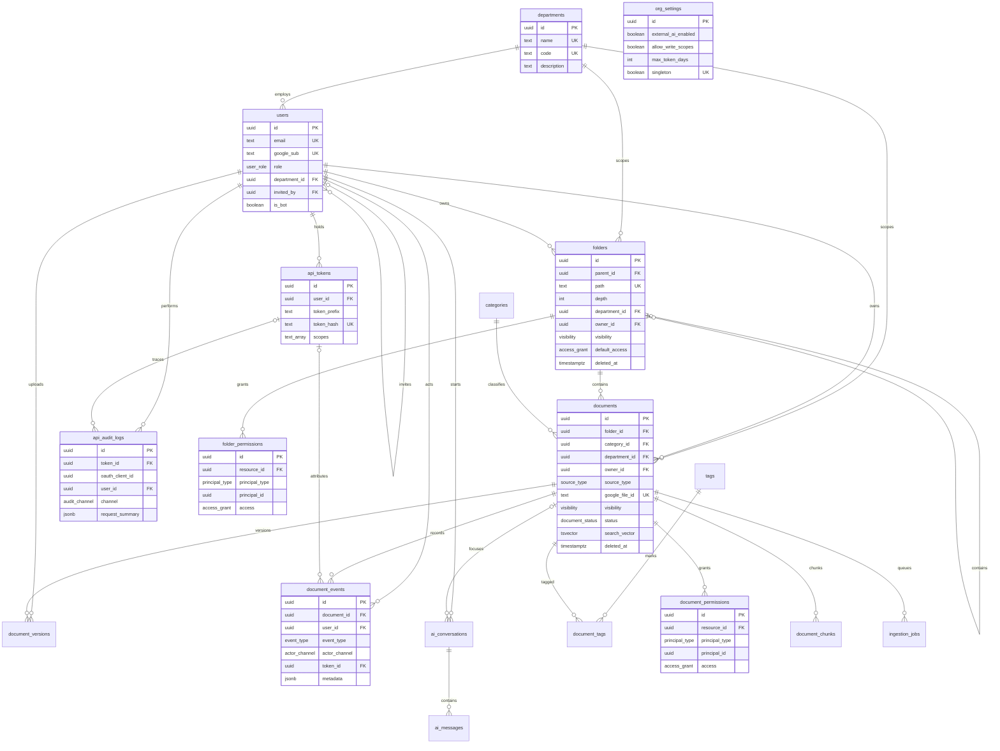

# Atlas data model

PostgreSQL 16, UUID primary keys, and `timestamptz` timestamps. Soft delete (`deleted_at`) exists on `folders` and `documents` only. Child rows that are derived from a document (`document_tags`, `document_versions`, `document_permissions`, `document_chunks`, `ingestion_jobs`, `ai_messages`) cascade on hard delete. `document_events` does not: it is the audit trail and the dashboard activity source, so a document row cannot be removed while its events remain.

`pg_trgm`, `vector`, and `pgcrypto` are enabled in the initial migration. `document_chunks` has no embedding column yet; `vector` is installed for the later chunk index. `ai_conversations` and `ai_messages` are created and unused in Phase 1. AI summary fields on `documents` stay null until that phase.

## Diagram

`principal_id` points at `users` or `departments` depending on `principal_type`, so it is not a foreign key. `oauth_client_id` is reserved for a future OAuth client table and is not a foreign key either.

## Enums

| Name | Values |
| --- | --- |
| `user_role` | `super_admin`, `admin`, `manager`, `employee`, `guest` |
| `visibility` | `private`, `department`, `organization`, `custom` |
| `access_grant` | `view`, `edit` |
| `source_type` | `google_doc`, `google_sheet`, `google_slide`, `pdf`, `docx`, `xlsx`, `ppt`, `txt`, `image` |
| `document_status` | `active`, `archived` |
| `drive_sync_status` | `pending`, `synced`, `failed`, `not_applicable` |
| `extraction_status` | `pending`, `processing`, `done`, `skipped`, `failed` |
| `principal_type` | `user`, `department` |
| `event_type` | `view`, `download`, `create`, `update`, `move`, `archive`, `restore`, `delete`, `share`, `read_content` |
| `actor_channel` | `web`, `rest`, `mcp` |
| `job_status` | `pending`, `running`, `succeeded`, `failed` |
| `conversation_scope` | `organization`, `document` |
| `message_role` | `user`, `assistant`, `system` |
| `audit_channel` | `rest`, `mcp` |

## Table dictionary

Nullable columns are marked. Everything else is required. `id` is a UUID primary key with `gen_random_uuid()` unless noted. Entity tables carry `created_at` and `updated_at`.

### departments

| Column | Type | Notes |
| --- | --- | --- |
| name | text | unique |
| code | text | unique slug (`product`, `hr`, …) |
| description | text | nullable |

### users

| Column | Type | Notes |
| --- | --- | --- |
| email | text | unique |
| name | text | |
| avatar_url | text | nullable |
| google_sub | text | unique, nullable |
| role | user_role | |
| department_id | uuid | FK `departments` |
| is_active | boolean | default true |
| is_bot | boolean | default false |
| last_login_at | timestamptz | nullable |
| last_seen_at | timestamptz | nullable |
| invited_by | uuid | nullable FK `users`, `ON DELETE SET NULL` |

### folders

| Column | Type | Notes |
| --- | --- | --- |
| name | text | |
| parent_id | uuid | nullable self-FK, cannot equal `id` |
| path | text | unique materialized path of folder keys, such as `/root/hr/policies` |
| depth | int | `0` at the root, check `>= 0` |
| department_id | uuid | FK `departments` |
| owner_id | uuid | FK `users` |
| visibility | visibility | |
| default_access | access_grant | |
| description | text | nullable |
| sort_order | int | default 0, check `>= 0` |
| deleted_at | timestamptz | nullable soft delete |

### categories

| Column | Type | Notes |
| --- | --- | --- |
| name | text | unique |
| description | text | nullable |

### tags

| Column | Type | Notes |
| --- | --- | --- |
| name | text | unique |
| description | text | nullable |

### document_tags

Append-only link. `created_at` only.

| Column | Type | Notes |
| --- | --- | --- |
| document_id | uuid | FK `documents`, cascade |
| tag_id | uuid | FK `tags` |
| created_at | timestamptz | |

Unique `(document_id, tag_id)`.

### documents

| Column | Type | Notes |
| --- | --- | --- |
| name | text | trigram GIN index |
| description | text | nullable |
| folder_id | uuid | FK `folders` |
| category_id | uuid | FK `categories` |
| department_id | uuid | FK `departments` |
| owner_id | uuid | FK `users` |
| source_type | source_type | |
| google_file_id | text | unique, nullable |
| google_mime_type | text | nullable |
| google_web_url | text | nullable |
| storage_key | text | nullable object key for an uploaded file |
| original_filename | text | nullable |
| mime_type | text | nullable |
| size_bytes | bigint | nullable, check `>= 0` |
| current_version_number | int | default 1, check `>= 1` |
| visibility | visibility | |
| default_access | access_grant | |
| status | document_status | default `active` |
| archived_at | timestamptz | nullable |
| deleted_at | timestamptz | nullable soft delete |
| last_modified_at | timestamptz | nullable |
| drive_sync_status | drive_sync_status | default `not_applicable` |
| drive_sync_error | text | nullable |
| content_text | text | nullable extracted text |
| content_hash | text | nullable sha256 hex of `content_text` |
| extraction_status | extraction_status | default `pending` |
| extraction_error | text | nullable |
| extracted_at | timestamptz | nullable |
| ai_summary | text | nullable, Phase 2 |
| ai_key_takeaways | jsonb | nullable, Phase 2 |
| ai_keywords | jsonb | nullable, Phase 2 |
| ai_topics | jsonb | nullable, Phase 2 |
| ai_processed_at | timestamptz | nullable, Phase 2 |
| search_vector | tsvector | nullable; maintained by `refresh_search_vector` |

### document_versions

| Column | Type | Notes |
| --- | --- | --- |
| document_id | uuid | FK `documents`, cascade |
| version_number | int | check `>= 1` |
| storage_key | text | nullable |
| original_filename | text | nullable |
| mime_type | text | nullable |
| size_bytes | bigint | nullable, check `>= 0` |
| uploaded_by | uuid | nullable FK `users` |
| change_note | text | nullable |

Unique `(document_id, version_number)`.

### document_permissions and folder_permissions

Same column shape. `resource_id` references `documents` or `folders` and cascades.

| Column | Type | Notes |
| --- | --- | --- |
| resource_id | uuid | FK to the parent resource |
| principal_type | principal_type | `user` or `department` |
| principal_id | uuid | id in the table named by `principal_type`; no FK |
| access | access_grant | `view` or `edit` |
| google_permission_id | text | nullable Drive permission id |
| created_by | uuid | nullable FK `users`, `ON DELETE SET NULL` |

Unique `(resource_id, principal_type, principal_id)`.

### document_events

Append-only. `created_at` only. Used for audit and for dashboard activity.

| Column | Type | Notes |
| --- | --- | --- |
| document_id | uuid | FK `documents`, restrict |
| user_id | uuid | FK `users` |
| event_type | event_type | |
| actor_channel | actor_channel | `web`, `rest`, or `mcp` |
| token_id | uuid | nullable FK `api_tokens`, `ON DELETE SET NULL` |
| client_name | text | nullable |
| metadata | jsonb | default `{}` |
| created_at | timestamptz | |

### document_chunks

No `embedding` column in this phase.

| Column | Type | Notes |
| --- | --- | --- |
| document_id | uuid | FK `documents`, cascade |
| version_number | int | check `>= 1` |
| chunk_index | int | check `>= 0` |
| text | text | chunk body |
| token_count | int | nullable, check `>= 0` |
| heading_path | text | nullable |
| content_hash | text | nullable |

Unique `(document_id, version_number, chunk_index)`.

### ingestion_jobs

| Column | Type | Notes |
| --- | --- | --- |
| document_id | uuid | FK `documents`, cascade |
| job_type | text | for example `extract` |
| status | job_status | default `pending` |
| attempts | int | default 0, check `>= 0` |
| last_error | text | nullable |
| run_after | timestamptz | nullable |
| started_at | timestamptz | nullable |
| finished_at | timestamptz | nullable |

### ai_conversations

Phase 2. Unused by Phase 1 behavior. `scope = organization` requires `document_id` null. `scope = document` requires `document_id`.

| Column | Type | Notes |
| --- | --- | --- |
| user_id | uuid | FK `users` |
| document_id | uuid | nullable FK `documents`, `ON DELETE SET NULL` |
| scope | conversation_scope | |
| title | text | nullable |

### ai_messages

Phase 2. Cascade from the conversation.

| Column | Type | Notes |
| --- | --- | --- |
| conversation_id | uuid | FK `ai_conversations`, cascade |
| role | message_role | |
| content | text | |
| sources | jsonb | default `[]` |

### api_tokens

`token_hash` is the hex sha256 of the secret. The secret itself is never stored.

| Column | Type | Notes |
| --- | --- | --- |
| user_id | uuid | FK `users`, the token owner |
| name | text | |
| token_prefix | text | indexed; shown in the UI |
| token_hash | text | unique |
| scopes | text[] | default `{}` |
| expires_at | timestamptz | nullable |
| last_used_at | timestamptz | nullable |
| last_used_ip | text | nullable |
| revoked_at | timestamptz | nullable |
| created_by | uuid | nullable FK `users`, `ON DELETE SET NULL` |

### api_audit_logs

Append-only external REST and MCP calls. `created_at` only. `request_summary` records the operation, never document content.

| Column | Type | Notes |
| --- | --- | --- |
| token_id | uuid | nullable FK `api_tokens`, `ON DELETE SET NULL` |
| oauth_client_id | uuid | nullable, no FK yet |
| user_id | uuid | FK `users` |
| channel | audit_channel | `rest` or `mcp` |
| operation | text | tool or endpoint name |
| status_code | int | |
| duration_ms | int | check `>= 0` |
| ip | text | nullable |
| user_agent | text | nullable |
| request_summary | jsonb | default `{}` |
| created_at | timestamptz | |

### org_settings

Exactly one row. `singleton` is always true, unique, and checked, which makes a second row impossible.

| Column | Type | Notes |
| --- | --- | --- |
| external_ai_enabled | boolean | default true |
| allow_write_scopes | boolean | default false |
| max_token_days | int | default 365, check `> 0` |
| singleton | boolean | default true, unique, check true |

The migration inserts that default row.

## Indexes

| Index | Definition |
| --- | --- |
| `ix_documents_search_vector` | GIN on `documents.search_vector` |
| `ix_documents_name_trgm` | GIN on `documents.name` using `gin_trgm_ops` |
| `ix_folders_path_pattern` | btree on `folders.path` using `text_pattern_ops` |
| `ix_documents_folder_id` | btree on `documents.folder_id` |
| `ix_documents_owner_id` | btree on `documents.owner_id` |
| `ix_document_events_document_id_created_at` | btree on `(document_id, created_at)` |
| `ix_api_audit_logs_created_at` | btree on `api_audit_logs.created_at` |
| `ix_api_audit_logs_user_id_created_at` | btree on `(user_id, created_at)` |
| `ix_api_tokens_token_prefix` | btree on `api_tokens.token_prefix` |
| `uq_document_versions_document_version` | unique `(document_id, version_number)` |

Foreign keys that are not already the leading column of one of those indexes have their own btree indexes.

## refresh_search_vector(document_id)

`refresh_search_vector(uuid)` rebuilds one document's `search_vector` with English `to_tsvector` weights:

| Weight | Source |
| --- | --- |
| A | `documents.name` |
| B | tag names joined with the category name |
| C | `documents.description` |
| D | `documents.content_text` |

The highest weight wins when the same lexeme appears in more than one field. Triggers call the function after a document insert or after a change to `name`, `description`, `content_text`, or `category_id`, and after any `document_tags` insert, update, or delete. The seed also calls the function once tags are attached.
